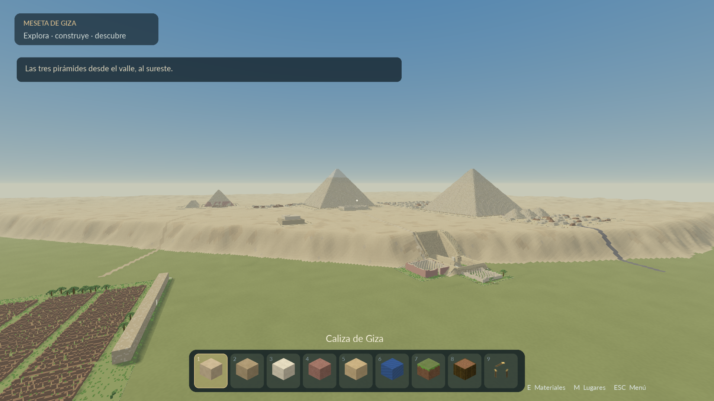
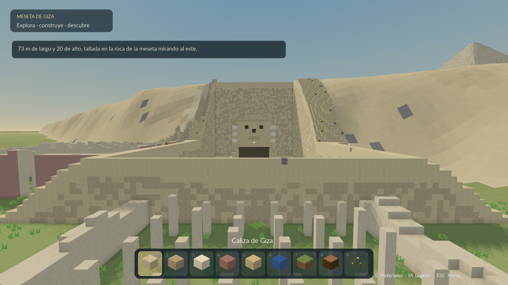
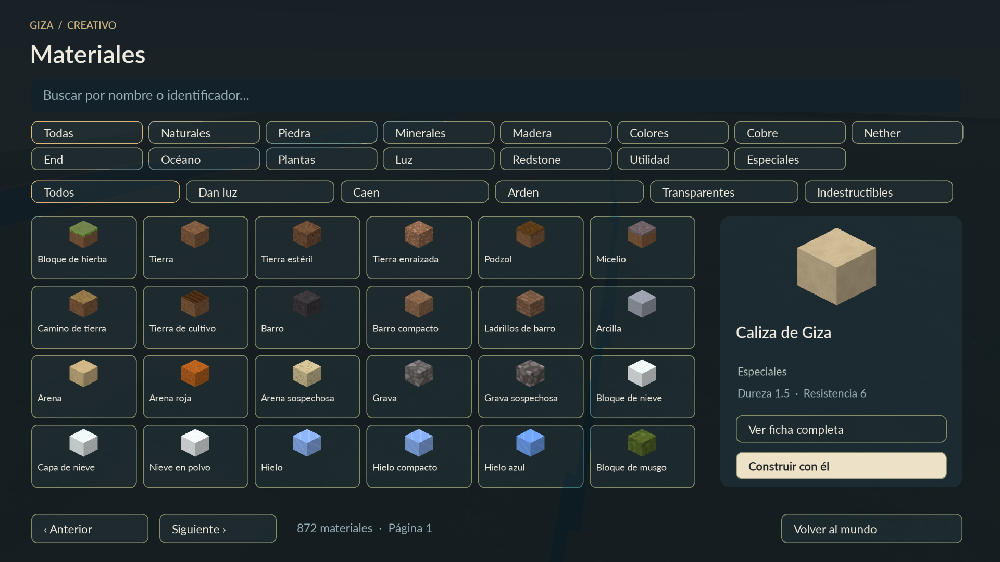
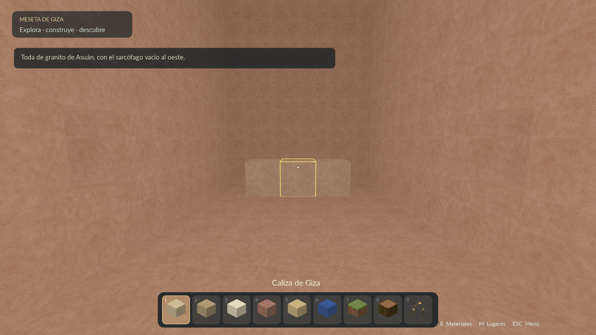

# Minecraft Giza

**Un juego de construcción y exploración en Python, creado para fines de entretenimiento.** Recorre la meseta de Giza a escala 1:1, entra en las pirámides y construye con un catálogo de 872 bloques.




## Qué puedes hacer

- Explorar **nueve pirámides**, la Esfinge, templos, calzadas, cementerios, el Muro del Cuervo, la aldea obrera y el valle del Nilo.
- Visitar pasadizos y cámaras: Gran Galería, Cámara del Rey, Cámara de la Reina, cámaras de descarga y cámara subterránea, entre otras.
- Saltar a **18 lugares** desde el menú, caminar, volar y atravesar paredes.
- Poner, quitar y copiar bloques; buscar materiales por nombre o identificador y consultar sus características y tiempos de minado de referencia.
- Guardar tus construcciones, posición y ajustes automáticamente.

El mapa mide **3008 × 3008 metros**. Un bloque representa un metro. Las medidas históricas son aproximadas y algunos pasadizos se ensancharon para poder recorrerlos.

## Galería

### La Gran Esfinge y los templos



### Materiales y construcción



### Interior de la Gran Pirámide



Las capturas provienen del juego nativo. Se pueden abrir en tamaño completo desde [docs/capturas](docs/capturas).

## Es una aplicación nativa de Python

El juego y su interfaz se ejecutan con **pygame, NumPy y PyOpenGL**. No hay HTML, CSS, JavaScript, servidor web ni navegador. Los shaders GLSL integrados en `giza_hd.py` se ejecutan en la GPU para dibujar los efectos gráficos.

La edición HD añade materiales de **128 × 128**, mipmaps, filtrado anisotrópico hasta 8×, antialiasing 4× cuando lo admite el controlador, sombras solares con filtro suave, oclusión ambiental, cielo atmosférico y agua con reflejo del cielo. Los monumentos lejanos conservan su geometría de bloques.

## Instalar y jugar

Necesitas **Python 3.12 o posterior**, un controlador gráfico funcional y **OpenGL 3.3 o posterior con perfil de compatibilidad**. Se ha comprobado en Linux con una NVIDIA GTX 1650. Windows y macOS no se han validado; en macOS la disponibilidad del perfil de OpenGL requerido puede impedir el inicio.

Descarga el repositorio completo o clónalo:

```bash
git clone https://github.com/javieratcservicios/Minecraft-Giza.git
cd Minecraft-Giza
python -m venv .venv
```

Activa el entorno:

```bash
# Linux
source .venv/bin/activate
```

```powershell
# Windows / PowerShell
.venv\Scripts\Activate.ps1
```

Instala las dependencias y abre el juego:

```bash
python -m pip install -r requirements.txt
python giza.py
```

Se abre a **pantalla completa**. Para probarlo en una ventana:

```bash
python giza.py --ventana --resolucion 1920x1080
```

No necesita Internet para jugar. **No descargues solamente `giza.py`**: el código, las fuentes y los datos del mapa deben permanecer juntos. El mapa se distribuye en cuatro archivos `giza_mapa.part*.bin` para respetar los límites de tamaño de GitHub; se leen directamente, sin Git LFS y sin tener que unirlos.

## Controles

| Control | Acción |
| --- | --- |
| WASD o flechas | Moverse |
| Ratón | Mirar |
| F | Alternar vuelo y caminar |
| N | Atravesar paredes |
| Espacio / Shift | Subir y bajar en vuelo |
| Espacio | Saltar caminando |
| Ctrl | Velocidad alta |
| Clic izquierdo, mantener para repetir | Quitar bloques |
| Clic derecho | Colocar el material seleccionado |
| Clic central | Copiar un bloque a la barra |
| 1–9 o rueda | Elegir ranura |
| E | Catálogo de materiales |
| M | Lugares |
| Esc | Menú de pausa |
| F3 | Coordenadas y rendimiento |
| F5 | Guardar |
| Alt+F4 | Salir y guardar |

También hay controles táctiles: arrastrar a la izquierda mueve; a la derecha mira; un toque coloca y mantener quita. Mantener una ranura abre el catálogo.

## Guardado y rendimiento

La partida se guarda cada tres segundos, al perder el foco y al salir, en `giza_partida.json`. El archivo se crea en tu equipo y está excluido del repositorio. Para trasladar tu partida, copia ese archivo junto al juego.

En **Ajustes** puedes cambiar la distancia de detalle, el campo de visión, la sensibilidad, el día/noche y las sombras. Si necesitas más rendimiento, reduce la distancia de detalle o desactiva las sombras solares. Restaurar el mapa solicita confirmación antes de borrar las construcciones.

## Cómo está armado el código

| Archivo | Responsabilidad |
| --- | --- |
| [`giza.py`](giza.py) | Entrada, bucle del juego, mundo por sectores, movimiento, colisiones, selección de bloques, edición y guardado. |
| [`mapa_datos.py`](mapa_datos.py) | Lector con `seek/read` para el mapa dividido; también acepta un mapa continuo local. |
| [`giza_hd.py`](giza_hd.py) | Motor gráfico OpenGL: materiales, VBO, shaders, cielo, agua, sombras y terreno lejano. |
| [`giza_ui.py`](giza_ui.py) | Menús, catálogo, fichas, iconos isométricos, tipografía y barra de materiales. |
| [`preparar_hd.py`](preparar_hd.py) | Reconstruye terreno y mallas exteriores HD desde los bloques del mapa. No es necesario ejecutarlo para jugar. |
| `giza_catalogo.json` | Propiedades de bloques, capas de textura, materiales, pirámides y puntos de visita. |
| `giza_indice.json` | Desplazamiento y longitud comprimida de cada sector del mapa. |
| `giza_mapa.part*.bin` | Datos del mundo original comprimidos con zlib. |
| `giza_texturas.bin`, `giza_atlas_hd.npy` | Texturas base y atlas HD generado. |
| `giza_terreno_hd.npz`, `giza_monumentos_hd.npz` | Mallas preparadas para ver el paisaje y los monumentos desde lejos. |
| `fuentes/` | Fuentes incluidas, con sus avisos de licencia. |

La explicación de las clases, los formatos de datos, el renderizado y cómo modificar el proyecto está en **[docs/ARQUITECTURA.md](docs/ARQUITECTURA.md)**.

## Verificación

```bash
python -m unittest discover -s tests -v
```

Las pruebas revisan la integridad de las partes del mapa, lecturas entre archivos, cámaras interiores y formato de las mallas. Para una comprobación gráfica breve en un equipo con OpenGL:

```bash
python giza.py --ventana --lugar panorama --prueba 60 --sin-guardar
```

## Alcance y créditos

Este proyecto es **para entretenimiento**. Conserva el estilo de construcción por bloques y un modo creativo simplificado: no hay supervivencia, criaturas, flujo de agua, caída de arena ni redstone funcional. Algunas formas son cajas simplificadas. No pretende ser una reconstrucción arqueológica exacta ni reproducir todas las reglas de Minecraft.

El mapa, catálogo y texturas base se adaptaron del proyecto [Giza Creativo](https://github.com/javieratcservicios/giza-creativo), del mismo autor. El mapa fue convertido previamente a datos comprimidos; el generador web original no se ejecuta en esta versión. Los recursos HD y la aplicación nativa están implementados en Python.

No es un producto oficial de Minecraft ni está afiliado con Mojang o Microsoft. Minecraft es una marca de sus respectivos titulares. Las fuentes Lato y DejaVu conservan sus licencias en `fuentes/`.
