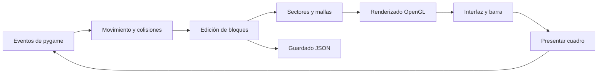

# Cómo está armado Minecraft Giza

## El recorrido de un cuadro



`giza.py` define `run(args)`, que inicializa pygame, crea la ventana OpenGL y carga la partida, si existe. El bucle procesa entradas, mueve al jugador, solicita sectores, incorpora mallas terminadas y presenta la escena. La velocidad de movimiento se multiplica por el tiempo transcurrido (`dt`), con un límite para evitar saltos grandes tras una pausa.

Las funciones locales de `run` comparten el estado de la partida. Entre ellas están `collision`, `ray`, `edit`, `invalidate`, `persist`, `teleport`, `ui` y `action`. Es una estructura pequeña orientada a un juego local; no hay red ni servidor.

## Mundo y datos

### Ejes y sectores

- **x** aumenta al este.
- **z** aumenta al sur.
- **y** representa la altura, entre 0 y 255.
- Un sector contiene **16 × 16 columnas**, cada una con 256 bloques de alto.
- Cada identificador de bloque ocupa dos bytes, un entero sin signo de 16 bits en orden little endian.

El centro de Keops está en `(x=0, z=0)`. El mapa publicado abarca aproximadamente `x=-1504…1503`, `z=-1008…1999`.

Cada sector se comprime de manera independiente con **zlib**. `giza_indice.json` relaciona la clave `"cx,cz"` con `[offset, longitud]`. Esos desplazamientos pertenecen a un flujo lógico continuo, aunque GitHub almacena ese flujo en varias partes.

### `MapReader`

`mapa_datos.py` oculta la división del archivo. Implementa `seek`, `read`, `close` y el protocolo de contexto `with`. Calcula dónde empieza cada parte y, cuando una lectura cruza un límite, une únicamente los bytes necesarios. No carga los 168 MB completos en memoria.

`giza_mapa.manifest.json` contiene el nombre, tamaño y SHA-256 de cada parte. El lector comprueba los tamaños; las pruebas verifican también las huellas. Si hay un `giza_mapa.bin` continuo local, el lector puede usarlo en lugar de las partes.

### `World`

La clase `World` de `giza.py` ofrece:

| Método | Qué hace |
| --- | --- |
| `tile(cx, cz)` | Lee y descomprime un sector, cambia el orden de sus ejes para usarlo en memoria y lo mantiene en una caché LRU. |
| `block(x, y, z)` | Devuelve el bloque de una posición; da prioridad a las modificaciones del jugador. |
| `set(pos, id)` | Registra un cambio permitido e incrementa la revisión del mundo. |
| `mesh(cx, cz)` | Construye las caras visibles del sector y separa sólidos y transparentes. |

La caché admite hasta 512 sectores. El acceso al archivo compartido usa un bloqueo para que los trabajadores no mezclen operaciones `seek/read`.

El mapa original permanece intacto. Las modificaciones se guardan aparte en `World.changes`, un diccionario de coordenadas a identificadores. El identificador `0` representa aire y permite guardar una eliminación sin modificar los datos base.

## Construcción de las mallas

`World.mesh` añade un borde de bloques vecinos para decidir qué caras quedan ocultas. Usa máscaras de NumPy para evitar dibujar las caras internas de bloques opacos.

Las plantas se representan con planos cruzados; las losas, puertas, vallas y otras formas utilizan cajas simplificadas definidas en `BOXES`. Las texturas se eligen con `FACE_TEX`, que distingue cara superior, lateral e inferior.

Cada vértice contiene nueve valores `float32`:

```text
x, y, z, u, v, acceso_al_cielo, oclusión_ambiental, emisión, alfa
```

Las coordenadas `u,v` señalan una capa del atlas. Los últimos cuatro valores viajan al shader por el atributo de color. El shader los interpreta como datos de iluminación, no como el color final del bloque.

Los sectores cercanos se solicitan a un `ThreadPoolExecutor`. La descompresión y la construcción de mallas ocurren fuera del hilo principal; las operaciones de OpenGL se realizan en el hilo que posee el contexto gráfico. Al editar un bloque se invalidan las mallas afectadas, incluidas las del otro lado de una frontera de sector.

## Motor gráfico: `HDRenderer`

`giza_hd.py` contiene la clase `HDRenderer`, los shaders y la creación del atlas HD.

### Tres capas del mundo

1. **Terreno lejano:** una malla de alturas con muestras cada cuatro metros. Excluye árboles y plantas para evitar picos artificiales.
2. **Monumentos lejanos:** geometría exterior de bloques preparada previamente, con aproximadamente 2.8 millones de vértices.
3. **Sectores cercanos:** mallas completas del mundo, con interiores y cambios del jugador.

Una textura de cobertura marca las regiones que ya tienen sectores cercanos. Los shaders descartan allí el terreno y los monumentos preconstruidos para que las construcciones y eliminaciones del jugador se vean correctamente.

Los recursos lejanos usan **VBO**. Las mallas cercanas se compilan en listas de dibujo del perfil de compatibilidad de OpenGL; por ese motivo no basta un contexto que solo admita el perfil moderno «core».

### Materiales

El atlas contiene celdas de 128 × 128 píxeles, con un margen de cuatro píxeles alrededor de cada una para reducir la contaminación entre materiales. La caliza, el granito y la arena tienen variación procedural de grano y relieve visual. Los demás materiales parten de las texturas base.

Se generan mipmaps y se activa filtrado anisotrópico cuando el controlador lo admite. Una paleta de colores medios estabiliza los materiales que ocupan menos de un píxel en pantalla. La celda de textura se determina por vértice para evitar que los bloques pequeños muestren colores de otras celdas.

`giza_atlas_hd.version` controla cuándo debe regenerarse el atlas. Si cambias el algoritmo de `make_atlas`, incrementa esa versión en el código y genera de nuevo el recurso.

### Iluminación y agua

El renderizado combina luz solar direccional, oclusión ambiental por esquina, una componente ambiental y una linterna que se activa en interiores. Las sombras se calculan desde una cámara orientada al sol mediante una textura de profundidad y se suavizan con varias muestras.

El mapa de sombras llega a 4096 × 4096; los renderizadores de software detectados utilizan una resolución menor. Las sombras se actualizan al cambiar la revisión del mundo o de manera periódica.

El cielo se dibuja con un shader de gradiente y sol; la distancia añade bruma atmosférica. El agua refleja una aproximación de ese cielo con ondulación visual. **No** es una simulación de fluidos ni una reflexión de toda la escena.

## Interfaz: `Interface`

`giza_ui.py` dibuja con pygame sobre una superficie transparente de alta resolución. Luego OpenGL compone esa superficie sobre el juego.

La interfaz trabaja en coordenadas lógicas de 1280 × 720, pero crea una superficie de mayor resolución para mantener nítidos los textos y los iconos. Las fuentes se incluyen en `fuentes/`, por lo que no depende de la selección de tipografías del sistema.

`Interface.draw(state)` recibe el estado que necesita y devuelve la superficie y los rectángulos de botones. Cada botón devuelve una acción que `action` procesa en `giza.py`. Los iconos isométricos se proyectan a partir de las texturas reales y se guardan en una caché.

## Movimiento, selección y edición

El jugador tiene un volumen aproximado de 0.56 × 1.78 metros. Las colisiones comparan ese volumen con las cajas del material. Los movimientos grandes se subdividen para reducir el riesgo de atravesar paredes. En modo caminar hay gravedad, salto y subida de escalones; el modo vuelo permite movimiento vertical. Atravesar paredes desactiva las colisiones.

`ray` avanza en pasos de 0.05 metros, hasta unos 14 metros, desde la cámara. Ignora líquidos y devuelve el bloque encontrado y la celda anterior. `edit` usa ese resultado para quitar, colocar o copiar un bloque. La colocación evita encerrar al jugador y la base del mundo está protegida.

## Guardado

`persist` construye un JSON con posición, orientación, barra, ajustes, modos y modificaciones. `save_atomic` escribe primero un archivo temporal y lo reemplaza al terminar. Esto reduce el riesgo de dejar un JSON parcial durante una escritura.

`giza_partida.json` no forma parte del repositorio. Los controles del juego son locales; no hay sincronización automática entre equipos.

## Preparar los recursos HD

Los datos ya están incluidos. Para regenerar las mallas lejanas:

```bash
python preparar_hd.py
```

El script lee los bloques del mapa, calcula alturas sin vegetación y extrae el exterior de los monumentos. Escribe `giza_terreno_hd.npz` y `giza_monumentos_hd.npz`. Puede consumir varios cientos de MB durante el proceso.

Esto **no genera un nuevo mapa histórico**: reconstruye recursos gráficos desde un mapa existente. Cambiar los puntos de visita o las propiedades visuales es distinto de modificar los bloques del mapa base.

## Dónde modificar cada cosa

| Quieres cambiar… | Busca en… |
| --- | --- |
| Movimiento, gravedad y velocidad | `run` en `giza.py` |
| Controles y atajos | Bucle de eventos de `giza.py` |
| Colisiones y formas parciales | `BOXES`, `collision` y `World.mesh` |
| Guardado | `persist` y `save_atomic` |
| Materiales y texturas HD | `make_atlas` en `giza_hd.py` |
| Cielo, agua, bruma e iluminación | Shaders de `giza_hd.py` |
| Menús, catálogo y barra | `Interface` en `giza_ui.py` |
| Lugares y descripciones | `lugares` en `giza_catalogo.json` |
| Recursos del horizonte | `preparar_hd.py` |

Los números de bloque son índices del catálogo y aparecen en el mapa y las partidas. Evita reordenarlos: agrega materiales nuevos al final o prepara una migración de identificadores.
